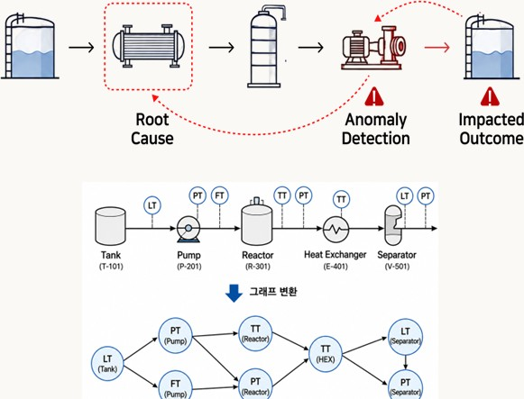
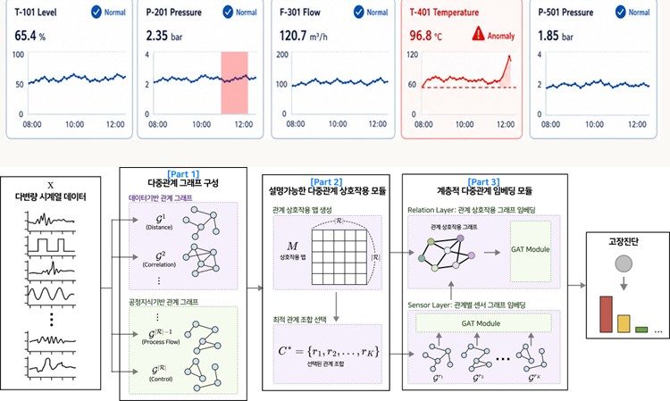
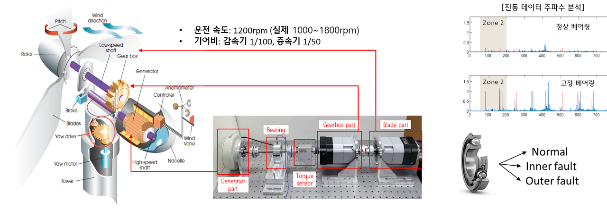
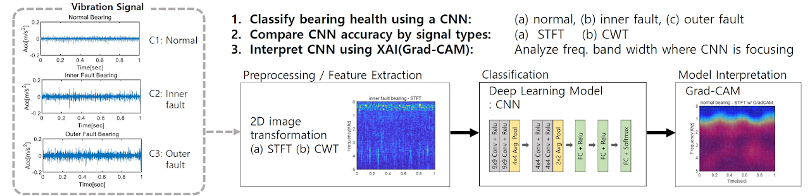
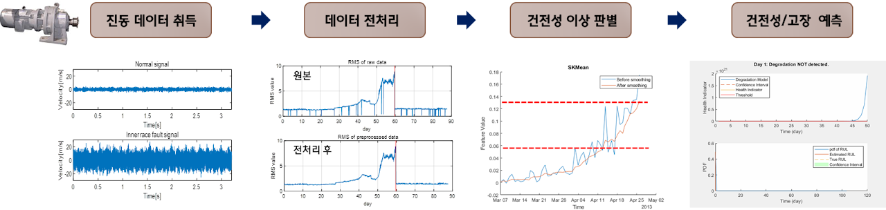
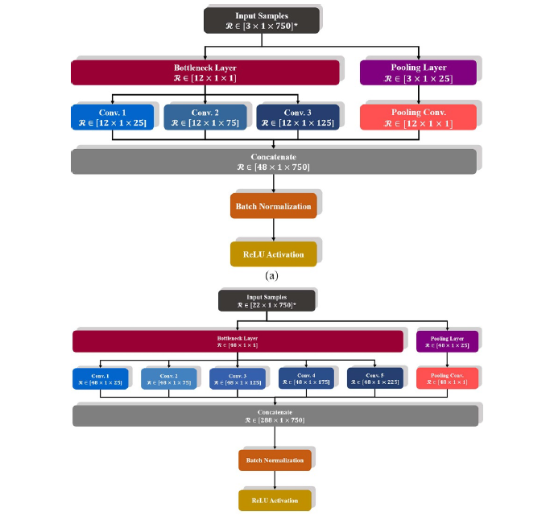

## Process-Knowledge Graph Models 공정 지식을 반영한 이상탐지 · 고장진단 · 고장원인 분석 {#process}

We build process expertise (equipment structure, process flow and operating
knowledge) into AI models for anomaly detection and root-cause diagnosis in
manufacturing processes. Adding this domain knowledge improves performance
over purely data-driven models.

### Process-Aware Equipment Anomaly Detection 2026

공정정보 기반 설비 이상탐지. A graph model for multivariate time-series
anomaly detection built from the equipment layout. It encodes the
sensor–equipment hierarchy and the process flow, detects when the process
becomes abnormal after learning from normal operation, and explains the likely
cause.

- State-of-the-art results on the SWaT and WADI water-treatment benchmarks; 1 SCIE paper in preparation

### Fault Diagnosis Using Multi-Relational Process Graphs 2026

산업공정 다중관계 기반 고장진단. Each sensor change is judged from the
viewpoint of the whole process flow: several data-driven and process-knowledge
relations between sensors are combined in one graph model of the process state.

- **96.8%** fault-diagnosis accuracy on the Tennessee Eastman Process (state of the art); 1 SCIE paper in preparation

## Rotating Machinery & Components 회전체 · 기계부품 진단 {#machinery}

### Rotating Machinery (Ball Bearing) Fault Diagnosis 2023

회전체(볼 베어링) 결함진단 모니터링 및 해석 — noise-robust bearing fault
diagnosis with time–frequency deep learning and explainable AI (Grad-CAM).
A physics-informed time–frequency multi-domain model with attention reaches
**99% detection accuracy** on the CWRU dataset (2 SCIE papers).

### Data-driven Remaining Useful Life Prediction 2023–

데이터 기반의 기계부품 잔류 수명 예측

### Motor Current Signature Analysis 2023–, in progress

Electric-machinery fault diagnosis — 전류 신호 기반의 유도전동기 결함진단
MCSA(Motor Current Signature Analysis) 기법 연구

## Other Signal AI 그 외 신호 기반 AI {#other}

### EEG-Inception 2020

An accurate and robust end-to-end neural network for electroencephalography
(EEG) based motor-imagery classification — joint research with Virginia Tech,
IOP Top Cited Paper Award (2024).

