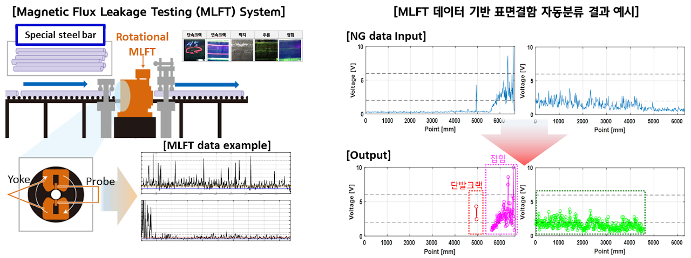
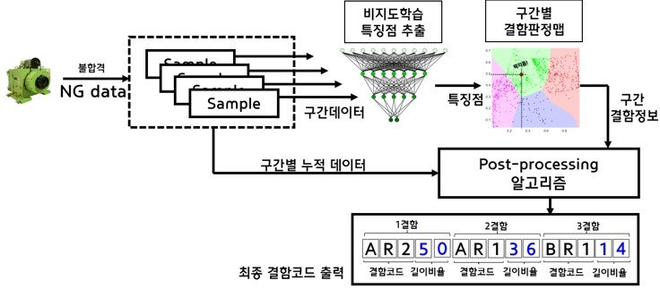
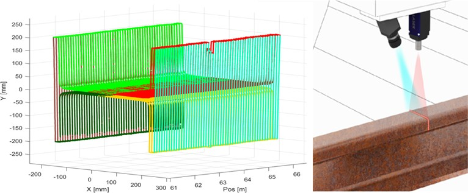
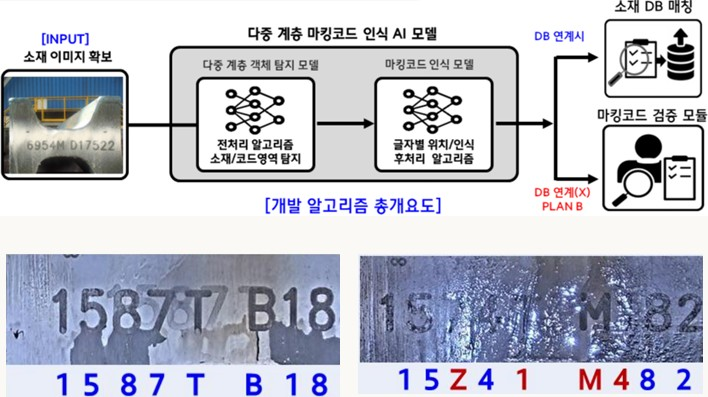
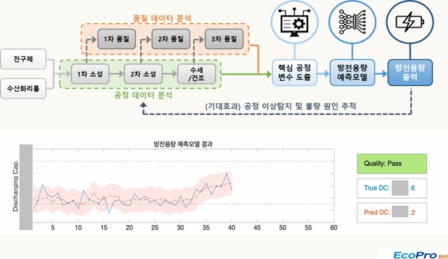
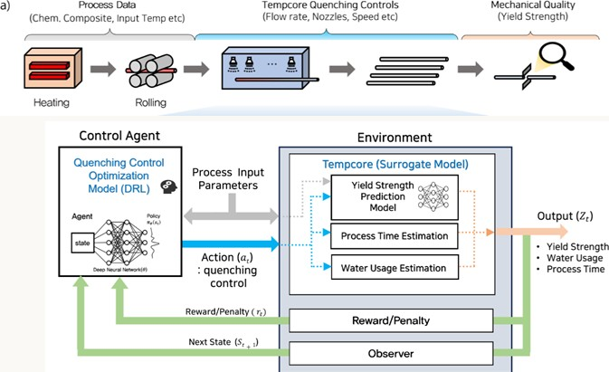
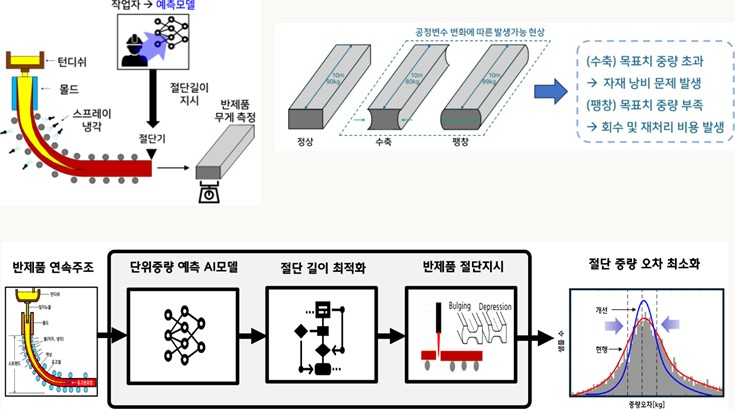

## Quality Inspection 공정 품질검사 {#inspection}

### Semi-supervised Steel Surface Defect Detection and Classification 2021–2024

준지도 학습 기반의 특수강 표면결함 탐지 및 결함 분류 — Hyundai Steel Pohang Works

- 오토인코더 기반 반지도학습을 활용한 특수강 표면결함 분류 기법 기초 연구 (2020–2023)
- 결함분류 온라인 학습모델 개발 연구 (진행 중, 2023~)
- Semi-supervised model for **7 defect types** with classification accuracy
  **over 99%**, applied at the Pohang plant (2024); 1 SCIE paper, 2 conference papers.
- The AI-based defect classification system has been running on the
  Hyundai Steel Pohang production line since January 2022
  ([보도자료](https://m.etnews.com/20220113000057)).

### Tip-Crack Defect Detection for Large H-Beams 2023–2025

대형 H-beam 팁터짐 불량 검출 (Hyundai Steel). Continuous 3D scan data of
large H-beams are processed to detect tip-crack defects.

- **100% detection rate**; field validation started in 2025

### Vision Recognition of Marking Codes on Rolling-Mill Feedstock 2025

대형압연 장입 소재 마킹 비전 인식 시스템 (Hyundai Steel). A multi-stage
marking-code recognition model for steel materials, fused with process
information and matched against the material database.

- **Over 98% accuracy**, including low-quality markings; installed on site

## Quality Prediction & Optimization 품질예측 · 최적화 {#prediction}

### Discharge Capacity Prediction for Battery Cathode Material 2023

이차전지 양극재 공정데이터 기반의 방전량 예측 모델 개발 (에코프로BM)

- Measuring discharge capacity in the lab takes **6 days or more**; the model
  predicts it in real time from process data, with an error of about
  **±0.57 mAh/g**.
- Next step: process anomaly detection and root-cause tracing based on the
  quality prediction.

### Prediction Model for Steel Material Property 2022–2023

특수강 재료특성 품질 예측 모델 개발

- 특수강 공정 재료특성 예측 모델 개발 (2022–2023): tensile strength / yield point / elongation prediction
- 냉각 공정 변수 최적화 모델 개발 (2023~, 진행 중)

### Tempcore Cooling-Variable Optimization 2023–2024

특수강 템프코어 냉각변수 최적화 — digital twin and deep reinforcement
learning for quenching control in reinforcement-bar manufacturing.

- AI model predicting rebar yield strength, a multiphysics digital-twin model,
  and reinforcement-learning optimization of cooling variables
- Better yield-strength quality and more efficient cooling-water use

### Weight Prediction and Cut-Length Optimization of Semi-Finished Steel 2023–2025

철강 반제품 중량 예측 및 절단길이 최적화 (Hyundai Steel). Predicts bulging
and unit weight of continuously cast semi-finished products and gives
cut-length optimization guidance to operators.

- Weight error improved by **18 percentage points** over the current method; 2 domestic conference papers

### Shift-Scheduling Optimization 2023

산업체 교대근무 스케줄링 최적화 — a reinforcement-learning based algorithm,
transferred to WeSEE (㈜위씨) in 2024.
