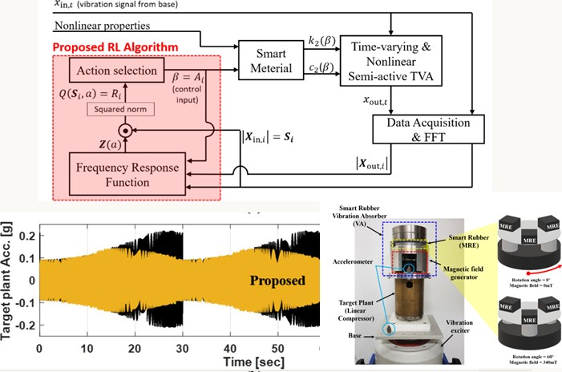

## Stiffness-Variable Smart Material 강성가변 스마트재료 · 진동제어 {#stiffness}

Magnetorheological (MR) elastomers and gels change their stiffness under a
magnetic field. We use them to build stiffness-variable vibration-control
modules (강성가변 진동제어 모듈) and smart-rubber vibration-isolation modules
for precision-part industries.

### Resonance Tuning System for Bladeless Vortex-Induced Wind Turbine 2022–2024

A small-scale bladeless wind turbine that harvests energy from vortex-induced
vibration, with a smart-rubber based resonance-shifting module that keeps the
structure in resonance as wind speed changes (해오름동맹 R&D, 한국수력원자력).

### Reinforcement Learning for Adaptive Tuning of Vibration Absorber 2020–2025

강화학습 기반 진동제어 기법 — model-free and domain-knowledge integrated
reinforcement-learning control of nonlinear MR-elastomer tunable vibration
absorbers under nonstationary excitation (한국연구재단 지역대학우수과학자지원사업).

- A smart vibration absorber that adapts to its operating environment,
  reflecting time-varying nonlinear behavior by combining reinforcement
  learning with vibration-dynamics knowledge
- Up to **58% vibration-energy reduction** (at 60 Hz); 2 SCIE papers

## Flexible Sensors 유연 센서 {#sensors}

Flexible sensors for vibration, magnetic field, and friction — self-sensing
MR elastomers and gels, CNT/graphene-oxide incorporated magneto-resistive
composites, and friction-variable rubber pads for robot grippers.
