## Safety: Hazardous-Zone Monitoring 위험구역 인체 · 이상행동 탐지 {#safety}

### LiDAR Virtual Safety Fence 2023

라이다 가상 안전펜스: 산업 현장 위험구역 인체 탐지 시스템 — automatically
detects people entering hazardous zones where CCTV cannot be installed, and
issues warnings. **100% intrusion-detection accuracy**; demonstrated at Hyundai Motor·Kia "2023 Ulsan E-Forest TECH".

  <figure>
<iframe src="https://www.youtube.com/embed/GjkRnkQgqtU" title="Safety fence demo — HGU smart factory lab" loading="lazy" allowfullscreen></iframe>
<figcaption>한동대학교 스마트팩토리 실험실 데모</figcaption></figure>
  <figure>
<iframe src="https://www.youtube.com/embed/96VuLY0tyZs" title="Safety fence demo — HGU power plant" loading="lazy" allowfullscreen></iframe>
<figcaption>한동대학교 파워플랜트 데모</figcaption></figure>

### LiDAR Dataset Generation in a Virtual Environment 2023

가상환경에서 라이다 데이터셋 생성 방법

- 산업현장 위험구역 출입 탐지를 위한 3D LiDAR 기반 객체 모델 개발 필요
- 현실적 제약 조건으로 현장 데이터 취득에 어려움 존재
- 산업 현장의 가상환경을 구축하여 3D 객체 모델 학습용 데이터 생성

<iframe src="https://www.youtube.com/embed/4U_p6O7Hhq4" title="LiDAR dataset generation in virtual environment" loading="lazy" allowfullscreen></iframe>

### Up-sampling Low-Resolution LiDAR for 3D Object Detection 2022

3D 물체인식 성능 향상을 위한 저해상도 라이다 업샘플링 기법

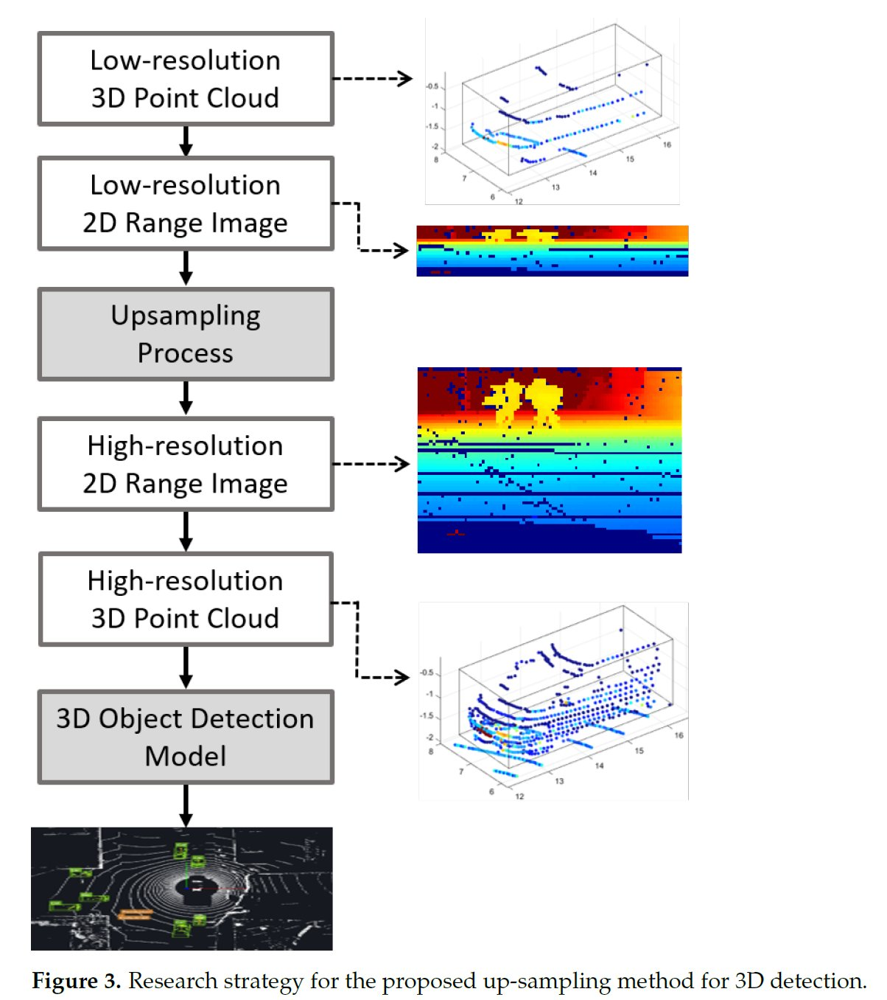

## LiDAR Calibration & Alignment Inspection 라이다 캘리브레이션 · 장착오차 검사 {#alignment}

### Auto-Calibration Program for LiDAR Installation 2023

라이다 설치 자동 보정 프로그램 개발 — auto calibration for LiDAR installation at industrial sites.

<iframe src="https://www.youtube.com/embed/OJX-mOkOY10" title="LiDAR installation auto calibration" loading="lazy" allowfullscreen></iframe>

### LiDAR–Vehicle Alignment Inspection 2020–2024

라이다-자동차 장착오차 자동 검사 시스템 개발. A misalignment of LiDAR as low
as a few degrees can cause significant errors in obstacle detection and
mapping. Our inspection systems estimate the orientation and horizontal
position of the LiDAR attachment with **sub-degree and millimeter-level
accuracy** for automobile production lines.

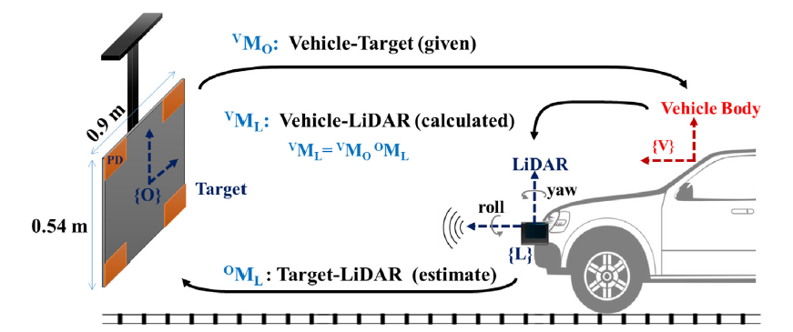

**Method 1 — 1D planar target.** Static method with a single target pose and
no camera or GPS; with a 16-channel Velodyne VLP-16, misalignment was
estimated within **0.2° and 4 mm**.

<iframe src="https://www.youtube.com/embed/koUs_ZEUY6o" title="Planar target based LiDAR alignment inspection" loading="lazy" allowfullscreen></iframe>

**Method 2 — 1-D photodetector arrays.** A target board with embedded
photodetector arrays; LiDAR pose estimated within **0.1° and 3 mm**.

<iframe src="https://www.youtube.com/embed/5RCuJTI90ZQ" title="Photodetector array based LiDAR alignment inspection" loading="lazy" allowfullscreen></iframe>

**Method 3 — cubic target.** One-shot, static inspection with a single cubic
target at less than 2 m; errors below **0.04° and 1 mm**.

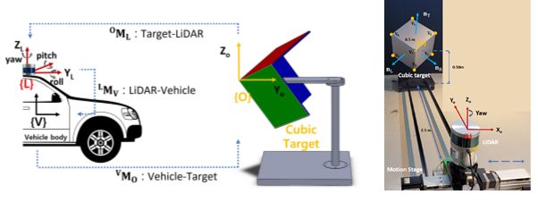

**Method 4 — NIR camera.** One-shot alignment inspection without accessing
LiDAR point-cloud data, using a near-infrared camera; mounting-error
precision under **0.1 mm**.

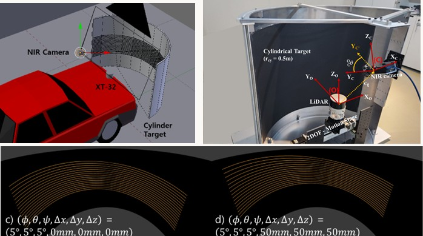

## Vision for Inspection & Automation 영상 기반 검사 · 자동화 {#automation}

### R2R CVD Tension Measurement Vision System 2023

그래핀 Roll-to-Roll CVD 공정 자동화를 위한 구리판 곡률·텐션 모니터링 머신비전 시스템 (그래핀스퀘어).
Non-contact tension monitoring inside a high-temperature vacuum chamber, with
lighting and image processing designed for specular (mirror-like) copper foil.

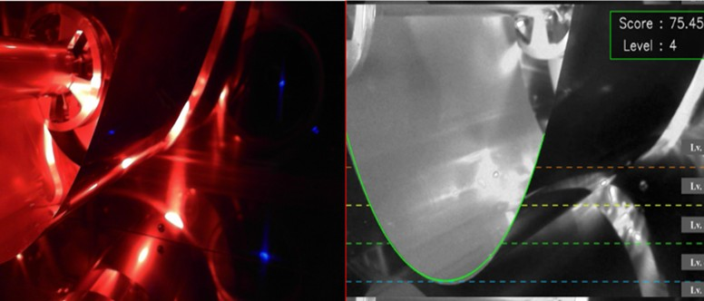

### Automatic Brick Height Measurement App 2023

벽돌 높이 자동 측정 앱 개발 — 성형단계 콘크리트 벽돌 높이 측정 자동화. 협력기업:
(주) 삼정산업 (기술이전 2024).

<iframe src="https://www.youtube.com/embed/RXGoq-BSASA" title="Brick height measurement app" loading="lazy" allowfullscreen></iframe>

### Aged-Lane Recognition for Automatic Lane Painting 2023

차선 도색 자동화를 위한 노후 차선 인식 및 경계선 검출 알고리즘 — 한동대 LINC3.0
산학 공동 기술 개발 과제 (기술이전: 성진에스이, 2023.2).

<iframe src="https://www.youtube.com/embed/94mYoxmYfgA" title="Lane recognition for lane painting" loading="lazy" allowfullscreen></iframe>

### RGB-D Camera based Volume Measurement 2019

사무실용 저가격/고해상도 체적 측정 시스템 개발을 위한 3D 카메라 기반 정형/비정형 물체 부피 측정 알고리즘 개발

- 화물을 포함하는 최소 크기의 직육면체의 가로, 세로, 높이로 표현
- 해상도 및 정확도: 직육면체 ±5 mm, 비정형 ±10 mm 이내
- 사각 50×50×50 ~ 600×600×600 mm³, 원통 ϕ30 × 30 cm

<iframe src="https://www.youtube.com/embed/N4y0ZZNC0xA" title="RGB-D volume measurement" loading="lazy" allowfullscreen></iframe>

### FPGA-based High-Speed Gear Inspection 2019

FPGA 기반 고속 기어 검사 시스템 — the bottleneck of the gear inspection
algorithm was accelerated **5.6×** through FPGA hardware design and data
minimization.

  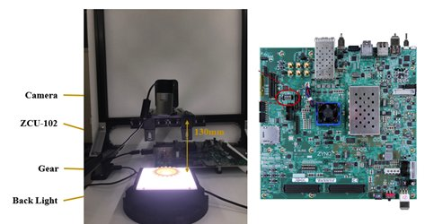
  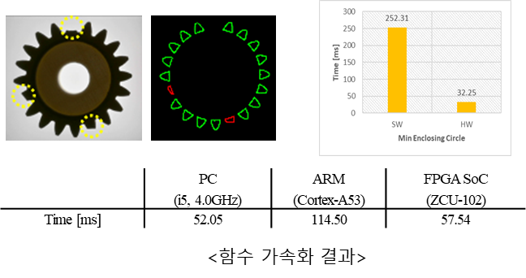

### Function Generator with FPGA 2019

Nexys4 DDR board — PWM, triangular, sawtooth and sine waves with adjustable
frequency, duty ratio, and amplitude.

<iframe src="https://www.youtube.com/embed/2diiO-BhAhE" title="Function generator with FPGA" loading="lazy" allowfullscreen></iframe>

### Lightweight Object Detection for Drone EO/IR Cameras 2020–2022

드론 임베디드 시스템 탑재를 위한 경량화 객체탐지 모델 — 열화상 이미지 기반 변전소 애자
고장 검출, and RGB + thermal blended images for insulator defect detection
and drone gaze-angle estimation.

  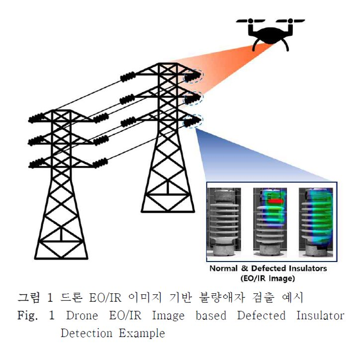
  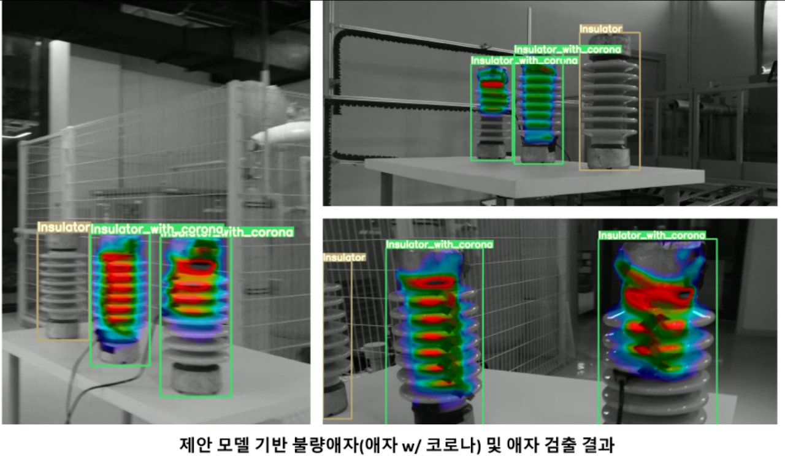

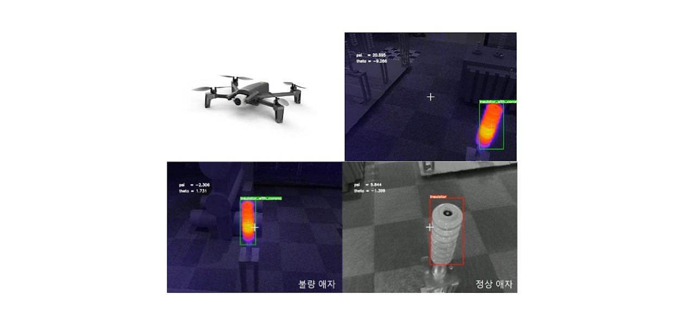

### Mono-Visual SLAM with Signposts 2018

도로 표지판 온라인 데이터베이스를 이용한 자동차 위치 추정 및 Visual Odometry 드리프트 보정

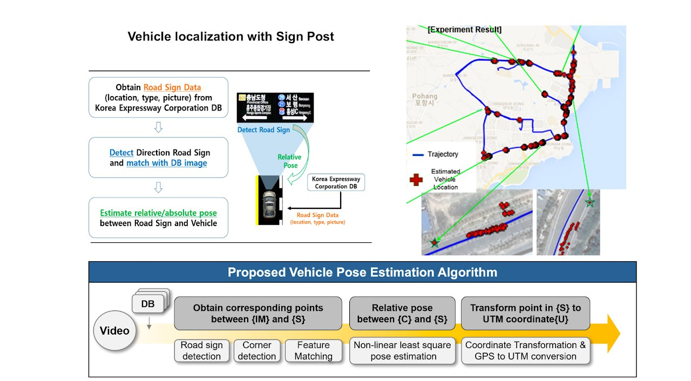

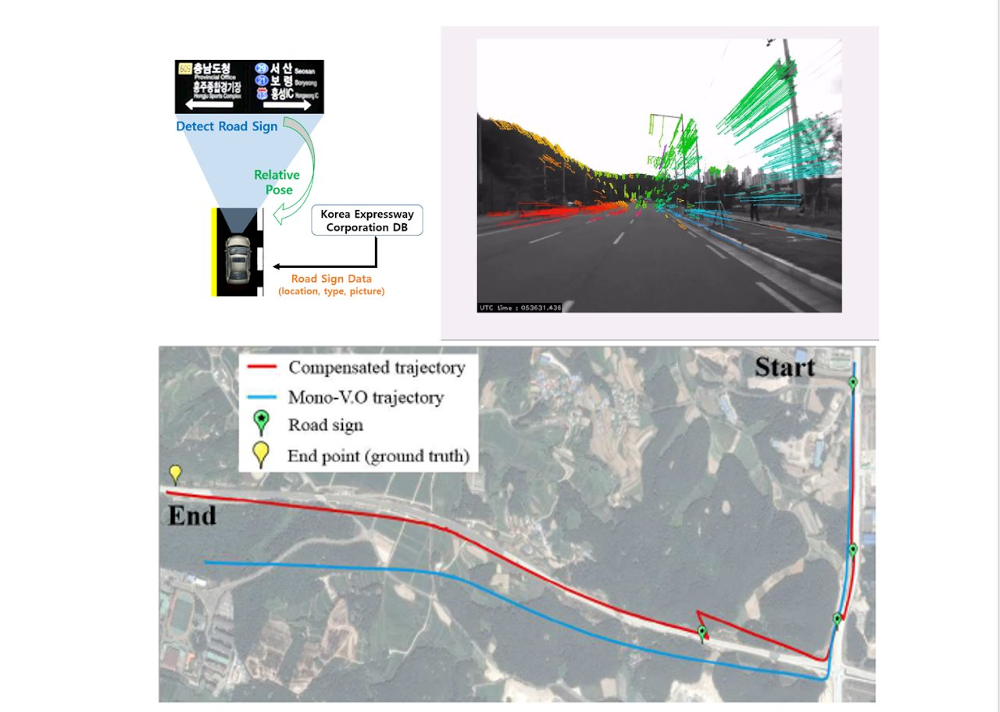

### Smart Parking Guidance System 2021

Prediction Model for Parking Free Space with Limited Number of CCTV — CCTV
정보 기반의 포항시 스마트시티 주차안내 시스템, 주차 여유 공간 예측 알고리즘 개발
(WeSEE × HGU).

<iframe src="https://www.youtube.com/embed/MpNni2Jw3Zk" title="Smart parking guidance system" loading="lazy" allowfullscreen></iframe>

